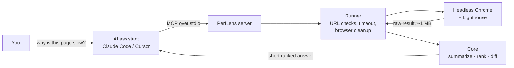

# PerfLens

**Why is my site slow? Ask your AI coding assistant.**

PerfLens is an [MCP](https://modelcontextprotocol.io) server that lets Claude Code, Cursor and other AI coding
assistants run Google Lighthouse performance audits, understand the results, and fix what matters most, right from
the chat. It runs on your machine, needs no account or API key, and works on public sites and local dev servers alike.

[](https://github.com/Anubhav-U/perflens-mcp/actions/workflows/ci.yml)
[](https://www.npmjs.com/package/perflens-mcp)
[](LICENSE)

<!-- Demo GIF goes here once recorded: docs/demo.gif -->

## Why

Lighthouse tells you why a page is slow, but in a report with 100+ items that takes an expert to turn into a plan.
Your AI assistant could act on it, but it can't run a browser, and pasting raw Lighthouse JSON into a chat wastes
its context on noise.

PerfLens runs the audit in a headless Chrome and hands the assistant only what matters: the score, the five lab
metrics with good/needs work/poor ratings, and a short list of fixes ranked by impact, each with the files or elements
causing it.

## Example

On a [deliberately slow demo page](site/public/demo/slow.html) and its [fixed version](site/demo-src/fast.html)
(real Lighthouse 12.8.2 runs, median of 3, simulated mid-range phone):

```
you > Why is /demo/slow.html so slow on phones? Fix the worst problems.

  perflens  audit_url("/demo/slow.html", mobile)
            score 39/100 · LCP 52 s (poor) · TBT 1.0 s (poor) · CLS 0.196

  perflens  suggest_fixes(audit)
            1. Load the LCP element sooner          ~50 s LCP
            2. Serve smaller, modern images         ~49 s LCP, 8.0 MB
            3. Prevent layout shifts                ~0.196 CLS
            4. Reduce main-thread work and long tasks  ~1.0 s TBT

assistant > The main image is a 3.9 MB PNG that JavaScript adds late and lazy-loads...
            [edits the page]

  perflens  compare_urls(before, after)
            score 39 → 100 · LCP 52 s → 910 ms · CLS 0.196 → 0
```

| Metric | Mobile before | Mobile after | Desktop before | Desktop after |
|---|---|---|---|---|
| Performance score | 39 | **100** | 54 | **100** |
| Largest Contentful Paint | 52 s | **910 ms** | 8.7 s | **248 ms** |
| Total Blocking Time | 1.0 s | **0 ms** | 110 ms | **0 ms** |
| Cumulative Layout Shift | 0.196 | **0** | 0.426 | **0** |

The fixes PerfLens ranked are exactly the changes that separate the two pages. The chat above is illustrative; the
numbers are real. Audits take about 7–15 s each.

## Install

Requires Node.js 20+ and Chrome, Chromium or Microsoft Edge.

**Claude Code**

```bash
claude mcp add perflens -- npx -y perflens-mcp
# Native Windows:
claude mcp add perflens -- cmd /c npx -y perflens-mcp
```

**Cursor**: add to `~/.cursor/mcp.json` (or `.cursor/mcp.json` in a project):

```json
{
  "mcpServers": {
    "perflens": {
      "command": "npx",
      "args": ["-y", "perflens-mcp"]
    }
  }
}
```

**Any other MCP client** that supports stdio servers: run `npx -y perflens-mcp`.

Then ask something like *"audit localhost:3000 on mobile and tell me what to fix first."*

## Tools

| Tool | What it does | Main inputs |
|---|---|---|
| `audit_url` | Runs Lighthouse on a page and returns the score, metrics with ratings, and ranked opportunities with evidence. | `url`, `device` (mobile/desktop), `runs` (1–5, median kept), `maxOpportunities` |
| `suggest_fixes` | A prioritized fix list: what to change, why, effort, estimated impact, and the resources involved. | `url`, or `audit` (a previous `audit_url` result, so nothing re-runs), `limit` |
| `compare_urls` | Metric deltas between two pages, or one page before/after a change. Differences within normal run-to-run noise are reported as unchanged. | `urlA`, optional `urlB` or `baseline`, `runs` |
| `explain_metric` | Plain-English explanation of LCP, FCP, CLS, TBT, Speed Index or INP: thresholds, causes, fixes. No audit needed. | `name` |

Every tool returns a short markdown summary for the model plus validated structured output (Zod schemas, MCP
`outputSchema`).

## How it works



- **[src/core](src/core)**: pure, deterministic logic. Turns a raw Lighthouse result into a summary, ranks fixes
  with [21 playbooks](src/core/playbooks.ts), and compares runs. Fully unit-tested against real captured results.
- **[src/runner](src/runner)**: validates the URL, finds a browser, runs Lighthouse with a hard timeout, and always
  closes the browser. Audits run one at a time.
- **[src/server.ts](src/server.ts)** and **[src/tools.ts](src/tools.ts)**: the four MCP tools, progress
  notifications, and readable errors.

## Engineering notes

Decisions worth calling out, including ones that changed after testing against real pages:

- **No LLM inside the server.** PerfLens always runs inside an AI assistant that already turns ranked fixes into
  explanations and code changes. A second model would add an API key, latency and failure modes for no gain, so the
  server stays deterministic, fast, free and testable.
- **Impact ranking that doesn't saturate.** Each fix is scored by the points a metric is currently losing times the
  share of that metric's gap to "good" the fix would close. A first version capped savings per metric and tied four
  different fixes at the top on a very slow page.
- **Lighthouse 12 reports most problems twice** (a legacy audit and a newer "insight"), and the two can disagree:
  `dom-size` failed with 800 ms of TBT savings while `dom-size-insight` passed. A legacy twin is dropped only when its
  insight also fails, and its savings carry over. Naive deduplication had dropped a 0.197 CLS estimate.
- **Noise bands, not raw deltas.** Re-auditing an unchanged page swung TBT from 104 → 0 ms and Speed Index from
  2.1 → 3.3 s. `compare_urls` treats changes inside per-metric bands as unchanged, and `runs` keeps the median-score run.
- **Small tool schemas.** MCP clients load every tool definition into the model's context in every chat. Passing a
  previous result back in is validated inside the handler instead of in the published schema, which cut the tool list
  from ~16K to ~11.7K characters.
- **stdout is sacred.** With the stdio transport, anything printed to stdout corrupts the protocol stream, so lint
  allows only `console.error`, and an end-to-end test drives the built server over real stdio.
- **Lighthouse is imported lazily**, so the server starts in well under a second and `explain_metric` works without
  loading it.
- **Fails readably.** No browser installed, a domain that doesn't resolve, a blank page, a timeout: each comes back as
  a plain-English tool error with what to do next, not a stack trace.

## Configuration

Optional environment variables, set in your MCP client's server config:

| Variable | Default | Purpose |
|---|---|---|
| `CHROME_PATH` | auto-detected | Browser executable to use. PerfLens looks for Chrome/Chromium, then Microsoft Edge. |
| `PERFLENS_TIMEOUT_MS` | `90000` | Per-audit timeout (15–300 s). Tools also accept `timeoutMs`. |
| `PERFLENS_CHROME_FLAGS` | none | Extra browser flags, e.g. `--no-sandbox` in Linux containers. |

## Limitations

- **Lab data, not field data.** Lighthouse simulates one device on one network. Real users vary; check field data
  (CrUX or your RUM) before big decisions.
- **INP isn't measured.** A navigation audit has no real interactions; TBT is the lab proxy. `explain_metric` says so.
- **Runs vary.** Use `runs: 3` or more when a decision depends on small differences.
- **One audit at a time**, and a cancelled tool call still finishes (or times out) in the background.
- **No logged-in pages yet.** There is no way to pass cookies or headers.
- **Impact estimates are for ranking.** Savings across fixes overlap, so they don't add up to a predicted score.

## Development

```bash
npm install
npm run build          # bundle to dist/ with tsup
npm test               # 120 unit tests (Vitest), no browser needed
npm run lint
npm run typecheck

PERFLENS_INTEGRATION=1 npx vitest run test/integration.test.ts   # real Chrome, real sites
node scripts/smoke-stdio.mjs                                     # drive the built server over stdio
npx @modelcontextprotocol/inspector node dist/index.js           # click through the tools in a browser
```

- `scripts/capture-fixtures.mjs` captures trimmed real Lighthouse results used as test fixtures.
- `site/` is the landing page (Next.js) with the before/after demo. `npm run precompute` re-audits its demo pages with
  PerfLens and writes the numbers the page shows. See [site/README.md](site/README.md).
- CI runs typecheck, lint, tests and build on Node 20 and 22, plus the site build. Pushing a `v*` tag publishes to npm
  with provenance.

## License

[MIT](LICENSE) © Anubhav Utkarsh
